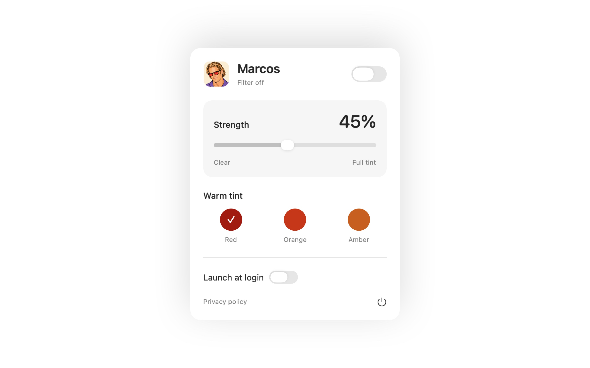

  
  <h1>Marcos</h1>
  
Warm screen tints for your Mac.

  
<a href="https://github.com/perezpaya/marcos/releases/latest"><strong>Download for macOS</strong></a> · <a href="https://github.com/perezpaya/marcos/releases">Releases &amp; release notes</a>

  
Free and open source · macOS 13 or later · Apple silicon and Intel

Marcos adds a warm tint to your screens, with a simple control in your menu bar. Choose red, orange, or amber, adjust the strength, and turn it on or off with one click.

<picture>
  <source media="(prefers-color-scheme: dark)" srcset="AppStore/Screenshots/02-controls-dark.jpg">
  
</picture>

- Apply the same tint across your connected displays, including full-screen apps.
- Keep your preferred color and strength saved between sessions.
- Enable **Launch at login** to keep Marcos ready when you sign in.
- See your selected tint in the menu bar glasses. Clear lenses show that the filter is off.

## Install

1. [Download the latest installer](https://github.com/perezpaya/marcos/releases/latest).
2. Open the `.pkg` file and follow the installation steps.
3. Open **Marcos** from **Applications** and look for the glasses in your menu bar.

The current installer is unsigned and unnotarized, so macOS may block installation or launch.

## Use Marcos

| Action | What happens |
| --- | --- |
| Click the menu bar glasses | Turn the tint on or off |
| Right-click or Control-click the glasses | Open color, strength, and login options |
| Set strength to 0% | Turn the tint off. The next toggle restores your previous strength |

The tint is off when you first open Marcos.

## Releases

| Version | Installer | Changes |
| --- | --- | --- |
| **1.2.2 · Latest** | [Download for Mac](https://github.com/perezpaya/marcos/releases/download/v1.2.2/Marcos-1.2.2-universal.pkg) | [Release notes](https://github.com/perezpaya/marcos/releases/tag/v1.2.2) |
| 1.2.1 | [Download for Mac](https://github.com/perezpaya/marcos/releases/download/v1.2.1/Marcos-1.2.1-universal.pkg) | [Release notes](https://github.com/perezpaya/marcos/releases/tag/v1.2.1) |

[Browse all releases](https://github.com/perezpaya/marcos/releases) for previous versions and download checksums.

## Support

[Report a problem or request a feature](https://github.com/perezpaya/marcos/issues).

[Privacy policy](PRIVACY.md) · [Build from source](DEVELOPMENT.md) · [MIT license](LICENSE)
